## Prepair the Certificate Service

For the CA to be able to use OCSP, read permission to the private key must be given.

Add Read permissions to Network Service on the private key
* Open the Certificate Templates snap-in.
* Select the OCSP Response Signing template.
* Right-click it and click on properties.
  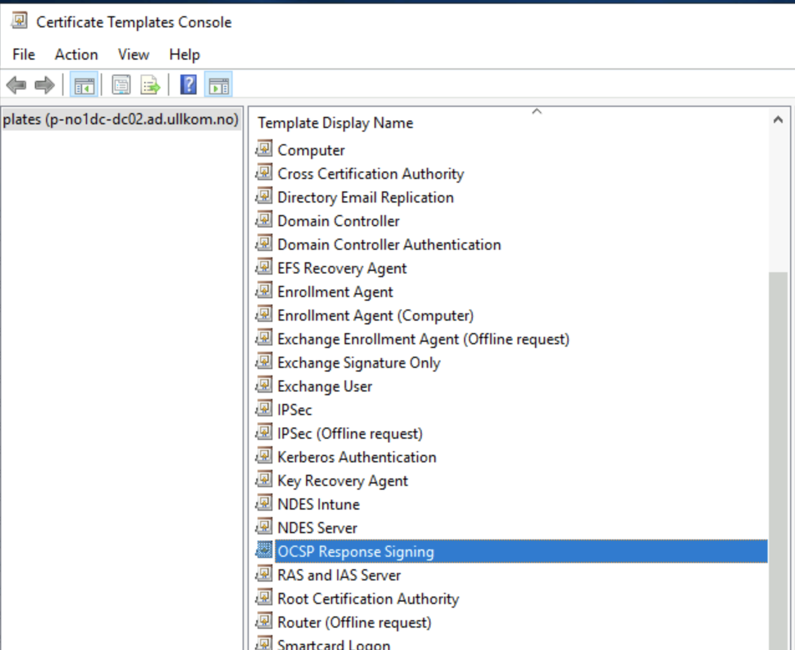

* Go to tab security. Click on add.
* In the dialog, select from the list of object types computer.
  * Search for the CA/OCSP computer. Click OK.
* Select the newly created entry with the computer name of the OCSP responder and select *ALLOW* for **Read** and **Enroll** permissions.
  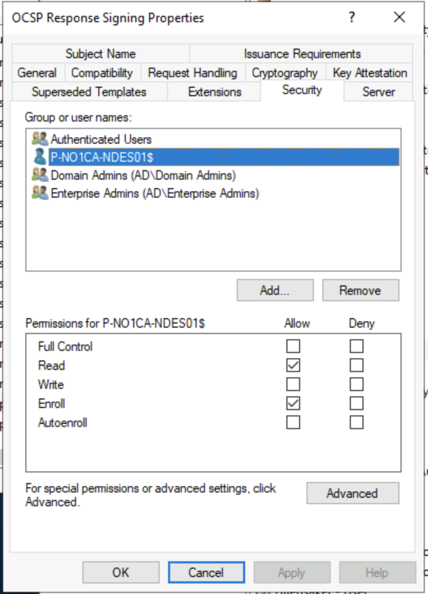

* Finish the task by clicking on OK.

## Publish the Certificate Template

Next, you will have to include the OCSP certificate in the list of available certificates of the CA.


* Open the CA snap-in 
* Select *Certificate Templates*
* Right click and choose “New Certificate Template to Issue”
  * Select the **OCSP Response Signing** certificate.

To check that it worked, select the certificate and open its properties.

## Online Responder Installation

```powershell
Add-WindowsFeature ADCS-Online-Cert
```

### Revocation Configuration

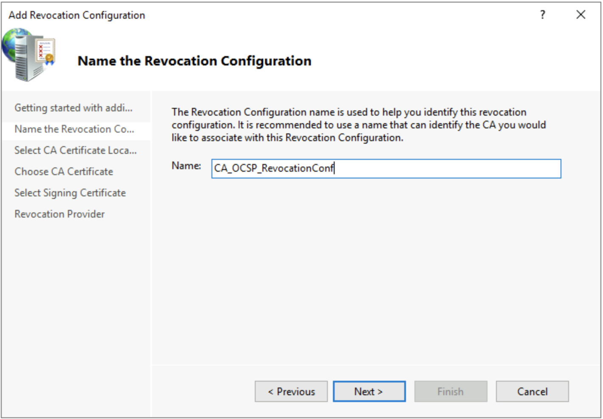

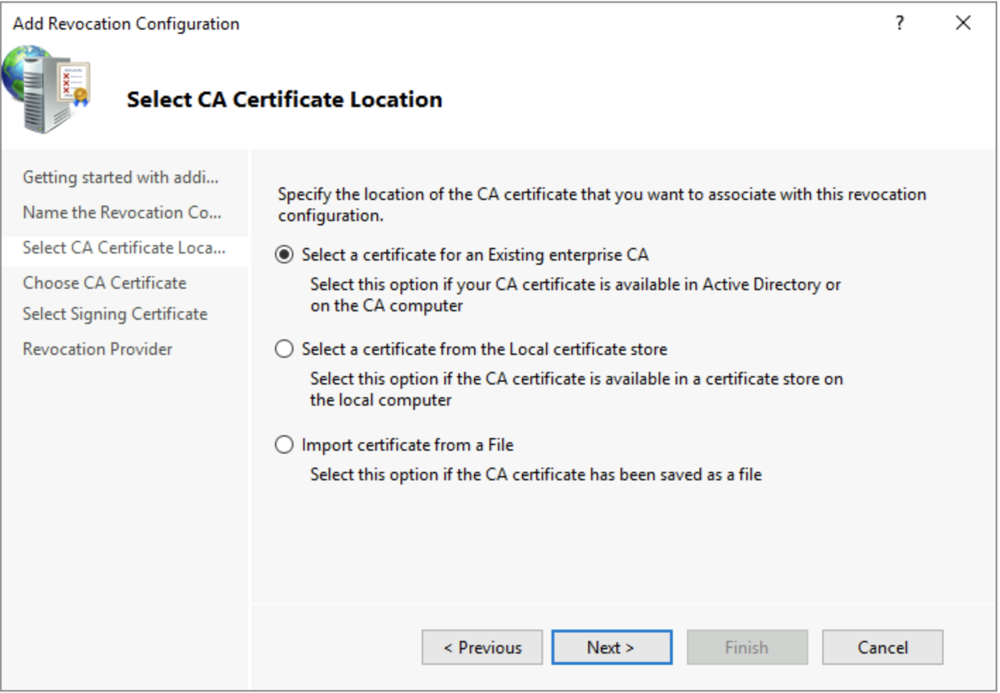

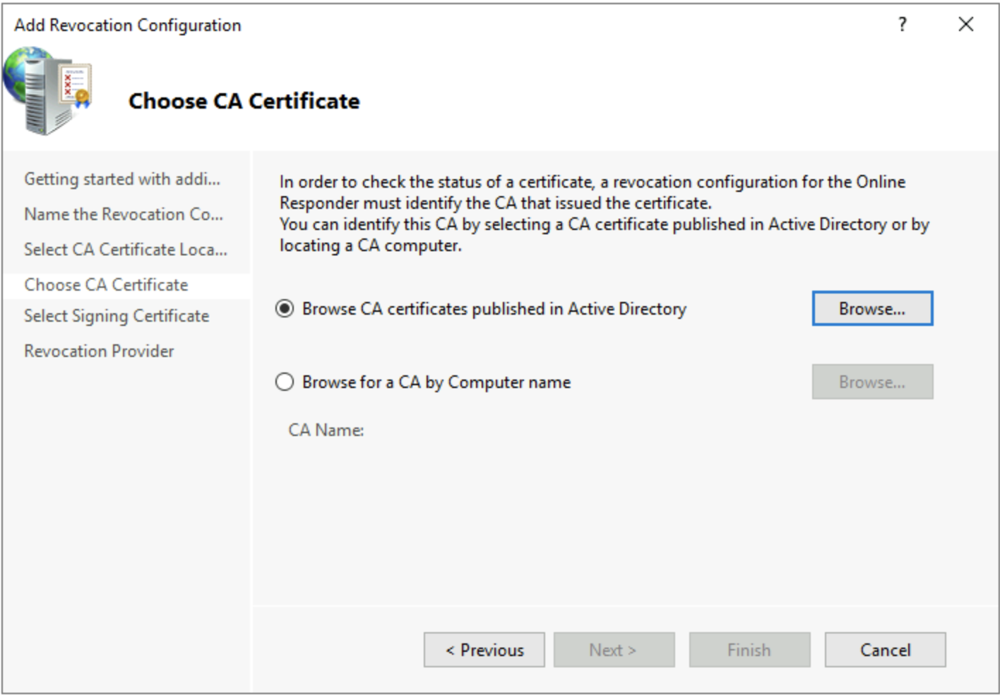

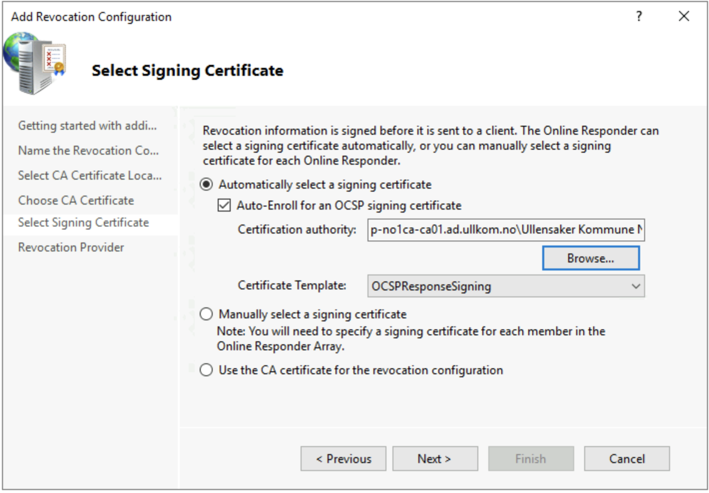

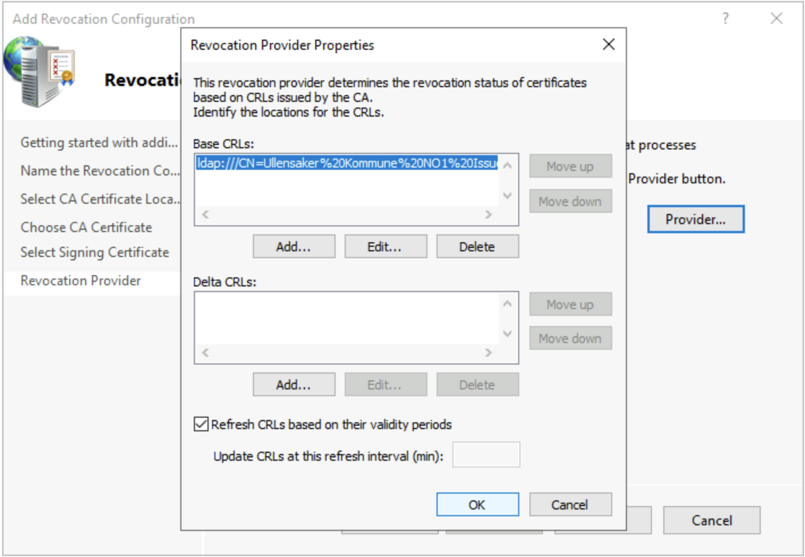

### Enable NONCE

Edit OCSP *Revocation Configuration* properties.

* Go to tab Signing and enable NONCE.
  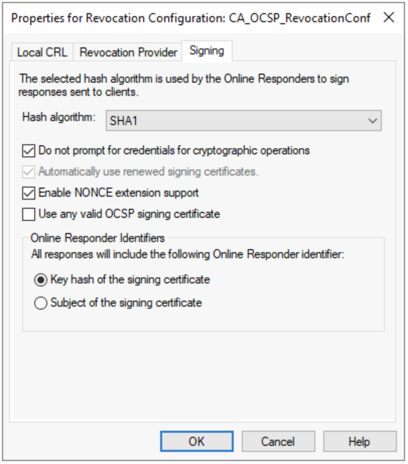

### Test the OCSP

In case you get a signing certificate not available for the array controller, do a refresh of the node.

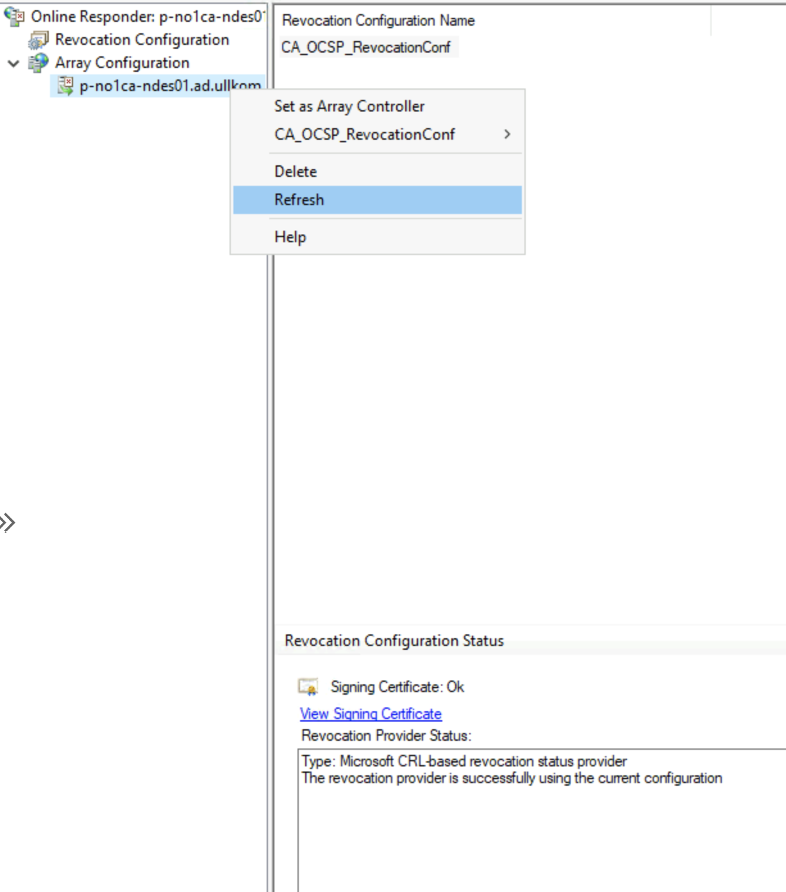

In the CA, an OCSP signing certificate must appear in the list of issued certificates.

## Configure CA

Open the Certification Authority snap-in.


* Open the properties of the CA.
* Open the **extensions** tab. By default, the CRL distribution point (CDP) list is shown. We need to change from **CDP** to **Authority Information Access** (AIA)
  
  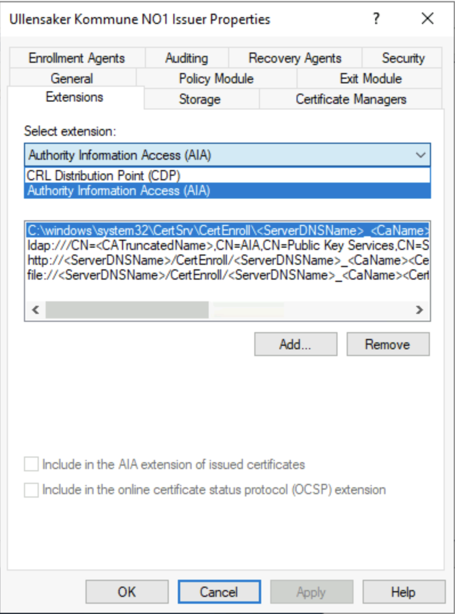

* Click on **Add** to add a new location.

  Specify the locations from which users can obtain certificate revocation data. This is the URL under which the OCSP service is installed.Make sure that the clients can resolve the DNS name and communicate with the service.

  http://<ServerDNSName>/ocsp


* Select “Include in the online certificate status protocol (OCSP) extension”. This makes the OCSP URL available in the certificate.

  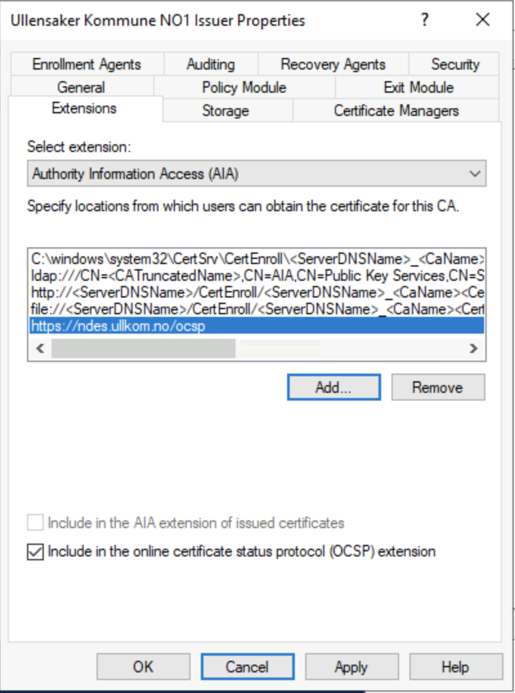

You will have to restart the CA service to make the new configuration effective.

---
<!-- enrich:containment -->
*Part of: damianflynn*
