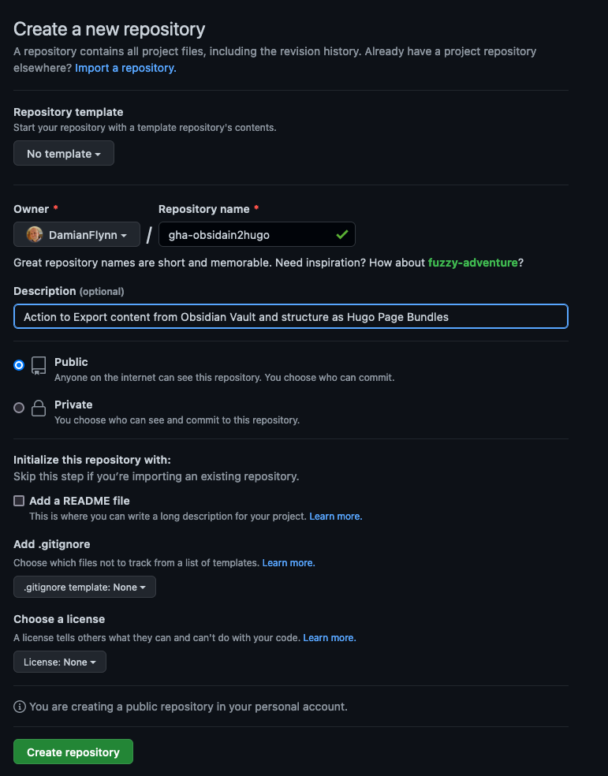

If you don’t already have a repo, create a new public repo on GitHub. _You cannot create and distribute your GitHub Action from a private repo._

For the purpose of this example, I will be creating a Python application to Export from Obsidian vault to Hugo blog as page bundles. I will be adopting the repository name of **gha-obsidian2hugo** to describe the purpose, with the prefix of *gha* to signify this is a GitHub Action.



Once you’ve created the #Git repository, we will clone it locally, and launch #VSCode.

```bash
git clone https://github.com/DamianFlynn/gha-obsidain2hugo.git
cd gha-obsidian2hugo
code .
```


## Azure Static Web App

### Custom Domain

*(image unavailable — “Static Web App - Add Custom Domain” screenshot not in source vault)*

---
<!-- enrich:containment -->
*Part of: damianflynn*
