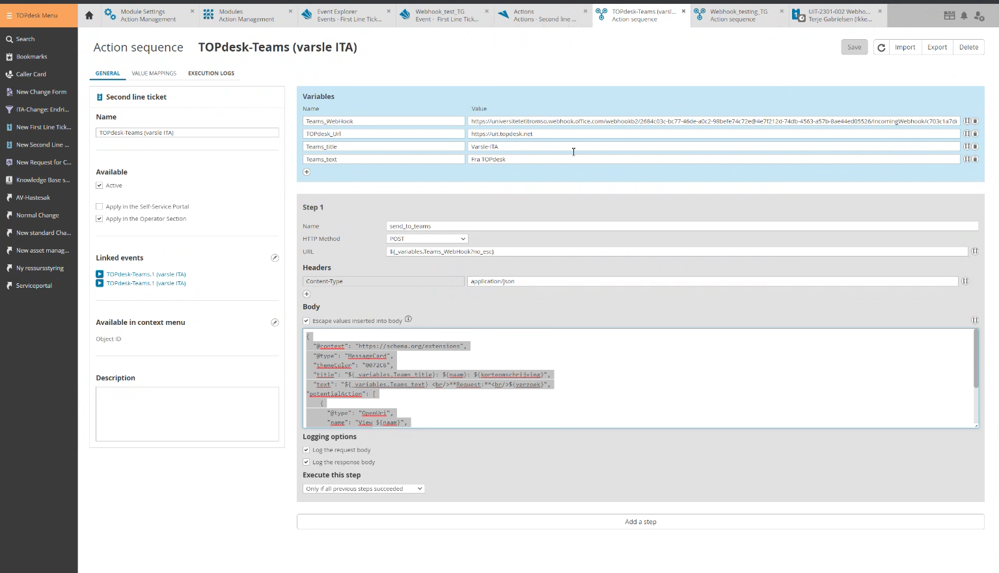

# Terraform Starting Quick

In the introduction to [Terraform](/posts/lang-terraform/) we got a general overview

## Getting Started

Now 

```bash
terraform init
terraform plan
terraform apply
terraform destroy
```



sample notes

---
<!-- enrich:containment -->
*Part of: damianflynn*
