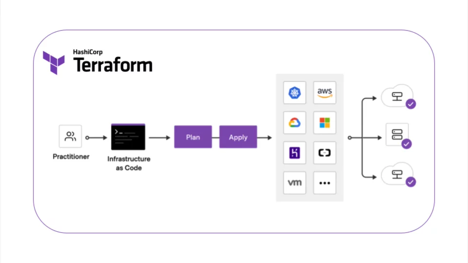

---
layout: post
title: Terraform
description: General Overview on Terraform
date: 2022-11-21
authors:
  - damian
draft: false
series: Terraform
alias:
  - Terraform
tags:
  - iac
  - terraform
categories:
  - desired state
image: https://via.placeholder.com/1200x800
image_caption: Photo by [Oliver Sjöström](https://via.placeholder.com/1200x800)
  on [Unsplash](https://via.placeholder.com/1200x800)
featured: true
toc: false
comments: false
---
# Terraform

This is an introduction to Terraform

## Getting Started

Read this to learn about [Strenghts of Terraform and Bicep](/posts/considering-terraform-and-bicep/)

---
<!-- enrich:containment -->
*Part of: damianflynn*
